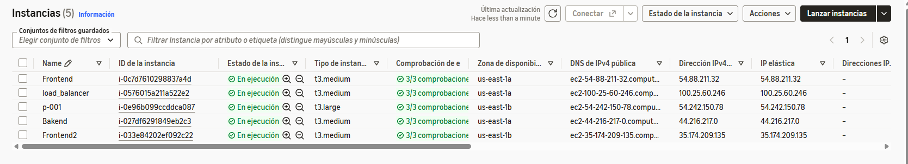
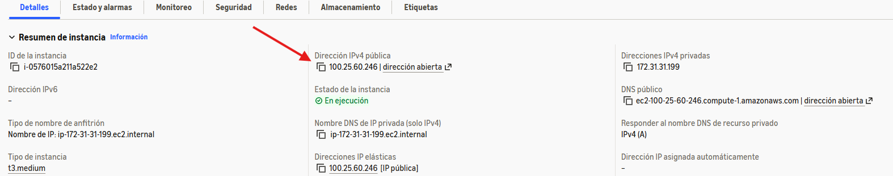
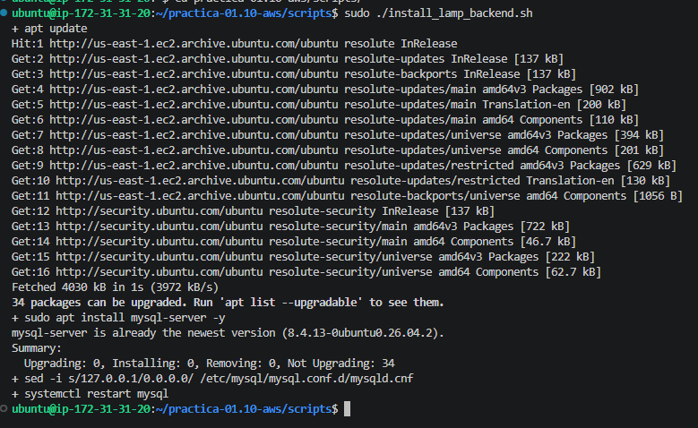
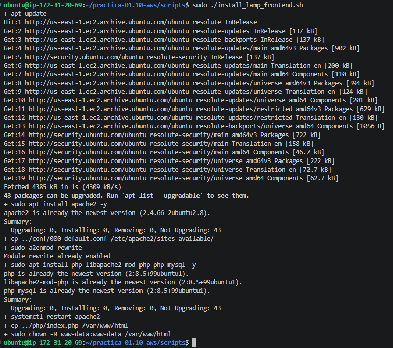
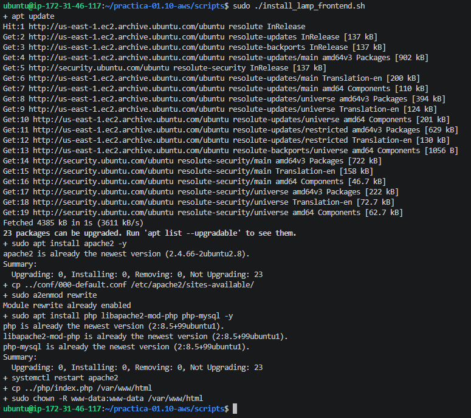
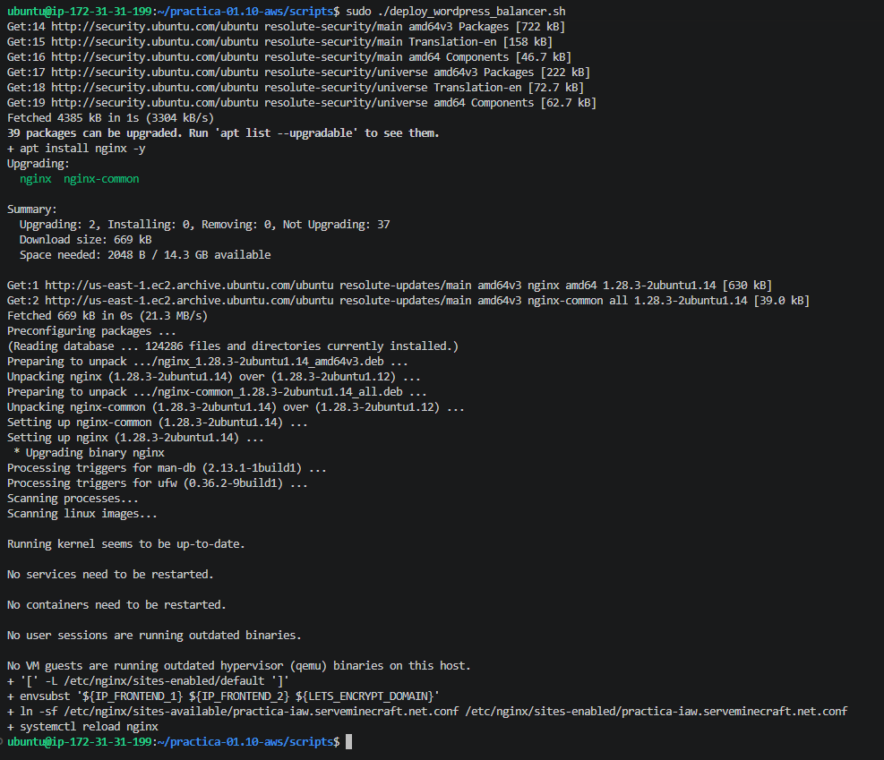
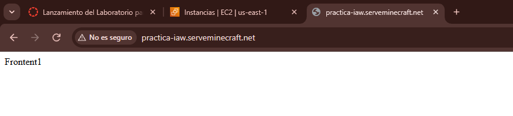
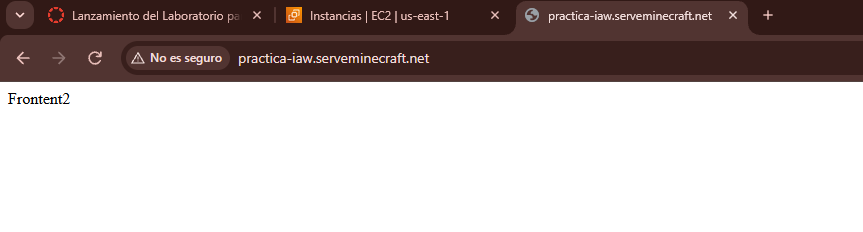

# practica-01.10-aws
# WordPress con balanceador de carga Nginx, dos frontends y backend MySQL

Guía paso a paso para desplegar **WordPress** en una arquitectura de tres capas sobre Ubuntu:

- Un **balanceador de carga Nginx** que recibe el tráfico, termina el HTTPS con **Let's Encrypt** y reparte las peticiones.
- **Dos frontends** Apache + PHP que sirven WordPress.
- Un **backend** MySQL con la base de datos compartida.

## 1. Arquitectura

```
                         Internet
                            │  80 / 443
                            ▼
              ┌───────────────────────────┐
              │  BALANCEADOR (Nginx)      │
              │  HTTPS (Let's Encrypt)    │
              └───────────────────────────┘
                   │ 80              │ 80
                   ▼                 ▼
        ┌────────────────┐  ┌────────────────┐
        │  FRONTEND 1    │  │  FRONTEND 2    │
        │  Apache + PHP  │  │  Apache + PHP  │
        └────────────────┘  └────────────────┘
                   │ 3306            │ 3306
                   └────────┬────────┘
                            ▼
              ┌───────────────────────────┐
              │  BACKEND (MySQL)          │
              └───────────────────────────┘
```

| Máquina | Software | Puertos |
|---|---|---|
| Balanceador | Nginx, Certbot | 22, 80, 443 (públicos) |
| Frontend 1 y 2 | Apache, PHP, WordPress | 22, 80 (solo desde el balanceador) |
| Backend | MySQL Server | 22, 3306 (solo desde los frontends) |

Solo el balanceador tiene IP pública y el dominio apunta a él. El certificado vive únicamente en el balanceador y los frontends sirven HTTP por la red privada.

## 2. Estructura del proyecto

```
.
├── README.md
├── .htaccess
│   └── .htaccess
├── conf
│   ├── 000-default.conf
│   ├── load-balancer.conf.template
│   └── virtualhost.conf.template
├── php
│   └── index.php
└── scripts
    ├── .env
    ├── install_lamp_backend.sh
    ├── install_lamp_frontend.sh
    ├── deploy_wordpress_backend.sh
    ├── deploy_wordpress-frontend.sh
    ├── deploy_wordpress_balancer.sh
    └── setup_letsencrypt_certificate.sh
```

| Archivo | Se ejecuta en | Función |
|---|---|---|
| `install_lamp_backend.sh` | Backend | Instala MySQL y lo abre a conexiones remotas. |
| `deploy_wordpress_backend.sh` | Backend | Crea la base de datos y el usuario de WordPress. |
| `install_lamp_frontend.sh` | Frontends | Instala Apache y PHP. |
| `deploy_wordpress-frontend.sh` | Frontend 1 | Instala WP-CLI y WordPress. |
| `deploy_wordpress_balancer.sh` | Balanceador | Instala Nginx y crea el balanceo entre los frontends. |
| `setup_letsencrypt_certificate.sh` | Balanceador | Instala Certbot y obtiene el certificado. |
| `conf/load-balancer.conf.template` | Balanceador | Plantilla del `server` de Nginx. |
| `conf/000-default.conf` | Frontends | VirtualHost por defecto de Apache. |
| `conf/virtualhost.conf.template` | — | Plantilla de Apache.|

## 3. Requisitos previos

- **Cuatro** máquinas Ubuntu Server con acceso `sudo` y en la misma red privada: balanceador, frontend 1, frontend 2 y backend.
- Una IP pública fija (por ejemplo, una IP elástica) para el balanceador.
- Un dominio que apunte a esa IP (aquí, `practica-iaw.serveminecraft.net` con No-IP).
- Repositorio clonado en las cuatro máquinas.

### 3.1. Crear las instancias

Crea las cuatro máquinas y anota la **IP privada** de cada una.



### 3.2. Configurar los grupos de seguridad

| Grupo | Puerto | Origen |
|---|---|---|
| Balanceador | 22 | Tu IP |
| Balanceador | 80 | `0.0.0.0/0` |
| Balanceador | 443 | `0.0.0.0/0` |
| Frontends | 22 | Tu IP |
| Frontends | 80 | Grupo de seguridad del balanceador |
| Backend | 22 | Tu IP |
| Backend | 3306 | Grupo de seguridad de los frontends |


### 3.3. IP fija y dominio

Asocia la IP elástica **al balanceador** y apunta el dominio a ella.




## 4. Archivo `.env`

En **todas** las máquinas, desde `scripts/`:

```bash
cd scripts
nano .env
```

```bash
# Dominio y correo para Let's Encrypt
LETS_ENCRYPT_DOMAIN="practica-iaw.serveminecraft.net"
LETS_ENCRYPT_EMAIL=admin@iescelia.org

# Base de datos de WordPress
WORDPRESS_DB_NAME=wordpress
WORDPRESS_DB_USER=wp_user
WORDPRESS_DB_PASSWORD=<contraseña_segura>
WORDPRESS_DB_HOST=<IP_PRIVADA_DEL_BACKEND>
IP_CLIENTE_MYSQL=<RED_DE_LOS_FRONTENDS>

# Sitio y administrador de WordPress
WORDPRESS_TITLE="IAW"
WORDPRESS_ADMIN_USER=admin
WORDPRESS_ADMIN_PASSWORD=<contraseña_segura>
WORDPRESS_ADMIN_EMAIL=admin@iescelia.org
WORDPRESS_LOGIN_URL=acceso-secreto

# Frontends (necesarias para el balanceador)
IP_FRONTEND_1=<IP_PRIVADA_FRONTEND_1>
IP_FRONTEND_2=<IP_PRIVADA_FRONTEND_2>
```

## 5. Paso 1: backend (MySQL)

Conéctate por SSH al **backend**.

```bash
cd scripts
chmod +x *.sh
sudo ./install_lamp_backend.sh
```




## 6. Paso 2: frontend 1 (Apache + PHP + WordPress)

Conéctate por SSH al **frontend 1**.

### 6.1. Preparar la configuración de Apache

Los frontends reciben el tráfico desde el balanceador y WordPress necesita `.htaccess` para los enlaces permanentes. Añade `AllowOverride All` a `conf/000-default.conf`:

```apache
<VirtualHost *:80>
  DocumentRoot /var/www/html/
  DirectoryIndex index.php index.html

  <Directory /var/www/html>
    AllowOverride All
  </Directory>

  ErrorLog ${APACHE_LOG_DIR}/error.log
  CustomLog ${APACHE_LOG_DIR}/access.log combined
</VirtualHost>
```


### 6.2. Instalar Apache y PHP

```bash
cd scripts
chmod +x *.sh
sudo ./install_lamp_frontend.sh
```

El script instala Apache y PHP, habilita `mod_rewrite`, copia `000-default.conf` y `php/index.php`, y asigna el propietario `www-data`.




## 7. Paso 3: frontend 2

Los dos frontends deben tener exactamente el mismo WordPress, y en particular el mismo `wp-config.php`. Las claves y *salts* se generan al azar en cada instalación; si fueran distintas, el inicio de sesión fallaría al saltar el balanceador de un frontend a otro. Pero en esta practica, pondremos distintas paginas para comprobar el funcionamiento del balanceador.

### 7.1. Instalar Apache y PHP

En el **frontend 2**:

```bash
cd scripts
chmod +x *.sh
sudo ./install_lamp_frontend.sh
```




## 8. Paso 4: balanceador (Nginx + HTTPS)

Conéctate por SSH al **balanceador**.

### 8.1. Corregir la plantilla de Nginx

`conf/load-balancer.conf.template` debe quedar así:

```nginx
upstream frontend_servers {
    server ${IP_FRONTEND_1};
    server ${IP_FRONTEND_2};
}

server {
    listen 80;
    server_name ${LETS_ENCRYPT_DOMAIN};

    location / {
        proxy_pass http://frontend_servers;

        proxy_set_header Host $host;
        proxy_set_header X-Real-IP $remote_addr;
        proxy_set_header X-Forwarded-For $proxy_add_x_forwarded_for;
        proxy_set_header X-Forwarded-Proto $scheme;
    }
}
```


### 8.2. Instalar y configurar Nginx

```bash
cd scripts
chmod +x *.sh
sudo ./deploy_wordpress_balancer.sh
```

El script:

1. Instala Nginx.
2. Elimina el sitio por defecto de `sites-enabled`.
3. Genera `/etc/nginx/sites-available/http://practica-iaw.serveminecraft.net.conf` con `envsubst`.
4. Lo activa con un enlace en `sites-enabled`.
5. Recarga Nginx.




### 8.3. Certificado de Let's Encrypt

```bash
sudo ./setup_letsencrypt_certificate.sh
```

El script instala Certbot con snap y ejecuta `certbot --nginx`, que obtiene el certificado, añade el bloque `listen 443 ssl` a la configuración de Nginx y redirige HTTP a HTTPS.


## 9. Verificación final

Para diferenciarlos, cambiaremos los index de nuestros dos frontent **frontent-d1** y **frontend2** escribiendo algo que nos permita diferenciarlos.

Abrimos `https://http://practica-iaw.serveminecraft.net`.






## 10. Orden de ejecución resumido

| Orden | Máquina | Comandos |
|---|---|---|
| 1 | Backend | `install_lamp_backend.sh`, `deploy_wordpress_backend.sh` |
| 2 | Frontend 1 | `install_lamp_frontend.sh`, `deploy_wordpress-frontend.sh`, editar `wp-config.php` |
| 3 | Frontend 2 | `install_lamp_frontend.sh`, copiar WordPress del frontend 1 |
| 4 | Balanceador | `deploy_wordpress_balancer.sh`, `setup_letsencrypt_certificate.sh` |